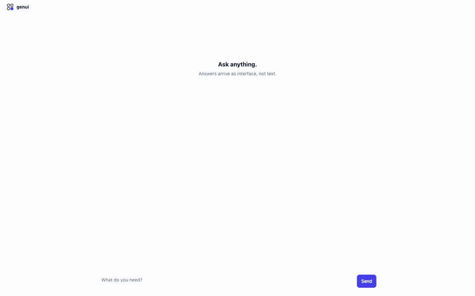
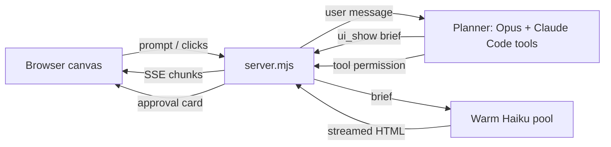
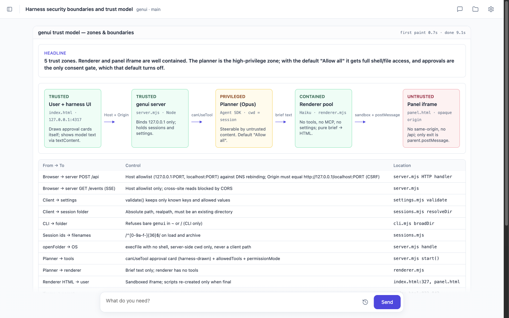

> A properly prompted modern LLM (Gemini 3) can robustly generate a full custom interactive web page for almost any prompt. Humans prefer it over markdown 82.8% of the time.
>
> — summarized from Leviathan et al., [*Generative UI: LLMs are Effective UI Generators*](https://arxiv.org/pdf/2604.09577), Google Research ([blog](https://research.google/blog/generative-ui-a-rich-custom-visual-interactive-user-experience-for-any-prompt/), [examples](https://generativeui.github.io))

**genui is a coding agent harness whose only output is interfaces it generates on the fly.** Ask about your code and, instead of a wall of markdown, you get a custom panel built for that answer: an architecture diagram, a diff to approve, a table of test results, buttons for next steps. You can click and comment on any part of it. It runs locally in your browser on your existing Claude Code login; run `genui` in a project to start.

It stays fast through orchestration: a strong model (Opus or Fable) does the thinking and writes a short brief, and pre-warmed fast models (Haiku) stream each brief into a panel. Panels start appearing in **~0.5–3 seconds instead of 1–2 minutes**. [Why this works →](#why-genui)



*Real-time capture, not sped up. Full video: [docs/demo.webm](docs/demo.webm).*

## Contents

- [Why genui](#why-genui)
- [How it works](#how-it-works)
- [Install](#install)
- [CLI](#cli)
- [Sessions](#sessions)
- [License](#license)

## Why genui

The paper shows people strongly prefer generated interfaces, but measured that *"when ignoring generation speed."* Its implementation has one model write each full page. genui keeps the paper's prompting principles (Appendix A.5) and post-processing ideas (A.6), and changes the architecture to remove both costs:

| Paper's limitation | genui's answer |
|---|---|
| **1–2 minutes per page** (streaming only halves the perceived wait) | A strong planner writes a short brief; pre-warmed fast renderers (first token ~0.7 s) stream the HTML, in parallel, while the planner keeps working. Panels show first content in **~0.5–3 s** and finish in ~5–14 s, and only the panel that changed is redrawn. What's left is mostly the planner's own tool use. |
| **Occasional JS/CSS/HTML errors** | Each panel is its own sandboxed iframe, so an error breaks one panel, not the page. Errors show as a badge, and a failed render falls back to the brief's text. |

**Why a smaller renderer doesn't cost quality.** Anthropic's own research finds that a strong model directing smaller ones holds up, and can even beat a single strong model:

- A [multi-agent system](https://www.anthropic.com/engineering/multi-agent-research-system) with Opus 4 leading Sonnet 4 subagents outperformed a single Opus 4 by **90.2%** on Anthropic's internal research eval.
- In the [advisor strategy](https://claude.com/blog/the-advisor-strategy), Haiku guided by Opus scored **41.2%** on BrowseComp, more than double Haiku alone (19.7%). Sonnet guided by Opus gained 2.7 points on SWE-bench Multilingual at 11.9% lower cost.

genui applies the same split: Opus (or Fable) does the reasoning, and Haiku only turns a finished brief into layout.

Nearby work, none of which combines a UI-only agent with a planner/renderer split: Gemini dynamic view, [Claude inline visualizations](https://thenewstack.io/anthropics-claude-interactive-visualizations/), [Thesys C1/OpenUI](https://www.producthunt.com/products/thesys/launches/openui-2), [Vercel json-render](https://github.com/vercel-labs/json-render), [Google A2UI](https://a2ui.org/introduction/agent-ui-ecosystem/), and MCP Apps.

## How it works



| Piece | Role |
|---|---|
| **Planner** (`claude-opus-5-5`) | Full Claude Code agent. Its text output is thrown away. It can only communicate through `ui_show(id, title, brief)`, `ui_ask(question, options)` and `ui_remove(id)`. |
| **Brief** | The planner decides *what* to say: the conclusion first, every fact verbatim, a suggested visual form, and optional `ACTIONS` that become buttons. |
| **Renderer** (`claude-haiku-5-5`) | Decides *how* it looks: an HTML + Tailwind fragment, styled consistently, using only facts from the brief. Prompt adapted from paper A.5. |
| **Stop hook** | A turn can't end without updating the canvas. As a last resort, the final text is rendered as a panel. |
| **Panels** | Sandboxed iframes (`allow-scripts`, no same-origin). `agent.send(payload)` is their only way back to the planner. |
| **Comments** | Press **C** (or the speech-bubble icon in the header), click any element in a panel and type. The planner gets the element's visible text with your comment, so you don't have to describe what you mean. Esc exits. |
| **Chat bar** | While the planner works, a line above the input shows what it's working on: your last prompt, click, comment or answer. The clock button lists everything sent in this session; click an entry to reuse it, or press ↑ in an empty input to recall earlier prompts. |
| **Approvals** | Drawn by the harness, never by a model, so the agent requesting an action can't design its own consent screen. MCP actions show as **MCP · server · tool**. |
| **Attachments** | Paste or drop images and files into the chat bar, or use **＋ → Attach files… / Attach folder…** (a native picker; nothing is uploaded, the planner gets the path). Images go to the planner inline; pasted or dropped files are saved under `~/.genui/uploads/`. |
| **MCP servers** | The planner gets the same MCP servers as your Claude Code: user and project config, plugins, and claude.ai connectors. **＋** lists them with live status. Your hooks are not loaded into the planner. |

## Install

Requirements: macOS or Linux, Node 22+, and the [Claude Code CLI](https://code.claude.com/docs/en/setup) logged in (`claude auth login`) *or* `ANTHROPIC_API_KEY` set.

```bash
npm i -g github:hschickdevs/genui
cd ~/some/project && genui
```

To hack on it, clone instead and link the command to your checkout: `git clone https://github.com/hschickdevs/genui && cd genui && npm install && npm link`. Or skip the command and run `npm start`.

| Env var | Default | Purpose |
|---|---|---|
| `GENUI_CWD` | current dir | Folder for the first session, when none exist yet |
| `GENUI_PLANNER_MODEL` | `claude-opus-5-5` | First-run default; then the ⚙ menu |
| `GENUI_RENDER_MODEL` | `claude-haiku-5-5` | First-run default; then the ⚙ menu |
| `GENUI_RENDER_WORKERS` | `3` | Warm renderer pool size |
| `GENUI_DIR` | `~/.genui` | Where sessions, settings and the server log are stored |
| `PORT` | `4317` | Local port (binds to 127.0.0.1 only) |

## CLI

`genui` starts a background server on first use, then opens the folder in your browser. Run it again in any folder and it reuses that server. An open genui tab switches to the folder instead of a new tab opening.

| Command | Does |
|---|---|
| `genui [dir]` | New session in `dir` (default: current folder); reuses an untouched one |
| `genui -c` | Continue the most recent session in this folder |
| `genui -r` | Pick a session for this folder from the sidebar |
| `genui --no-open` | Print the URL instead of opening a browser |
| `genui stop` | Stop the server (refuses while sessions work; add `--force`) |

- The server keeps running after you close the terminal. Its log is `~/.genui/server.log`.
- A bare `genui` in `~` or `/` is refused. Name the folder explicitly if you mean it.
- Update: `genui stop && npm i -g github:hschickdevs/genui`. Uninstall: `genui stop && npm rm -g genui` (and `rm -rf ~/.genui` to drop sessions and settings).

## Sessions

A **session** is one Claude Code session (same id, same title) plus its canvas. You can run several per folder.

| Action | How |
|---|---|
| Show or hide the sidebar | ⌘B / Ctrl+B |
| Jump to a session | ⌘K / Ctrl+K, type, ↑↓, Enter |
| New session in the current folder | **＋ New session** (or **+** on a folder heading) |
| New session elsewhere | The folder icon next to **New session** opens a folder picker, or run `genui` in that folder |
| Rename | Double-click the title in the header |
| Archive | **×** on an idle session in the sidebar |

- Claude Code names sessions automatically, and they also appear in `claude --resume` in that folder.
- Sessions and their canvases are saved to `~/.genui/sessions/`. An idle session frees its process after 15 minutes and resumes, with its memory, on the next prompt.
- The sidebar dot pulses indigo while a session works and turns amber when it needs your approval or answer. Those sessions are listed under **Needs you**.



## License

[PolyForm Noncommercial 1.0.0](LICENSE.md): free for personal, research, hobby and other noncommercial use. For a commercial license, contact me:

[](https://t.me/hschickdevs) [](mailto:hschickdevs@gmail.com)
