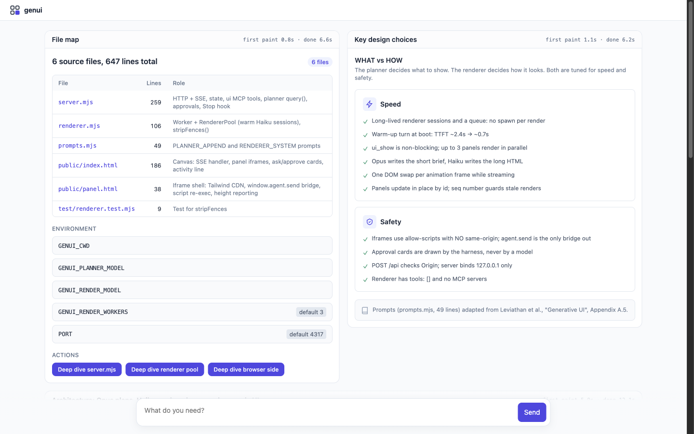
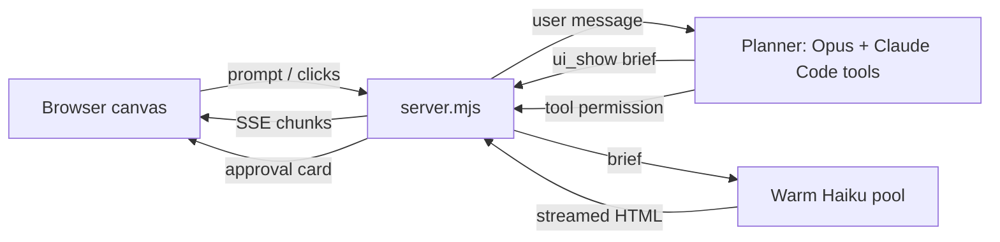
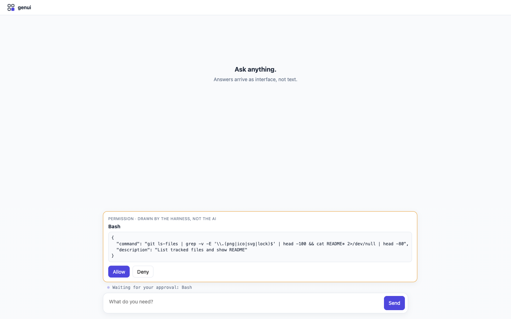

An agent harness on the [Claude Agent SDK](https://code.claude.com/docs/en/agent-sdk/overview) where **the only output is generated UI**. There is no markdown and no chat transcript. A strong model (Opus) does the thinking and tool use, then hands short briefs to a pool of fast models (Haiku) that stream them into interactive panels.




*Real-time capture, not sped up: "How does the renderer pool keep panels fast?" Opus reads the code, then Haiku streams the answer into a panel. Full video: [docs/demo.webm](docs/demo.webm).*

## Why

The thesis comes from Google Research's [*Generative UI: LLMs are Effective UI Generators*](https://arxiv.org/pdf/2604.09577) (Leviathan et al.; [blog](https://research.google/blog/generative-ui-a-rich-custom-visual-interactive-user-experience-for-any-prompt/), [examples](https://generativeui.github.io)):

| Finding | Number |
|---|---|
| Generative UI preferred over standard markdown output | **82.8%** of pairwise comparisons (Elo 1710.7 vs 1459.6) |
| At least comparable to pages built by human experts | **44%** of cases |
| Capability is emergent | Output errors: 60% on Gemini 2.0 Flash-Lite → 0% on newer models |
| **Main limitation** | **Slow: "a minute or two" per page.** Streaming roughly halves perceived wait. |

These results were measured *"when ignoring generation speed."* This project takes the paper's prompting principles (A.5) and post-processing ideas (A.6) and concentrates on the part it left open: **speed**, inside an agent that does real work.

Nearby work, none of which combines a UI-only agent with a planner/renderer split: Gemini dynamic view, [Claude inline visualizations](https://thenewstack.io/anthropics-claude-interactive-visualizations/), [Thesys C1/OpenUI](https://www.producthunt.com/products/thesys/launches/openui-2), [Vercel json-render](https://github.com/vercel-labs/json-render), [Google A2UI](https://a2ui.org/introduction/agent-ui-ecosystem/), and MCP Apps.

## How it works



| Piece | Role |
|---|---|
| **Planner** (`claude-opus-5-5`) | Full Claude Code agent. Its text output is thrown away. It can only communicate through `ui_show(id, title, brief)`, `ui_ask(question, options)` and `ui_remove(id)`. |
| **Brief** | The planner decides *what* to say: the conclusion first, every fact verbatim, a suggested visual form, and optional `ACTIONS` that become buttons. |
| **Renderer** (`claude-haiku-5-5`) | Decides *how* it looks: an HTML + Tailwind fragment, styled consistently, using only facts from the brief. Prompt adapted from paper A.5. |
| **Stop hook** | A turn can't end without updating the canvas. As a last resort, the final text is rendered as a panel. |
| **Panels** | Sandboxed iframes (`allow-scripts`, no same-origin). `agent.send(payload)` is their only way back to the planner. |
| **Approvals** | Drawn by the harness, never by a model, so the agent requesting an action can't design its own consent screen. |

## Speed

| Technique | Effect |
|---|---|
| Renderer workers are long-lived CLI sessions fed by a queue | No process spawn per render |
| One warm-up turn per worker at boot | First token: ~2.4s cold → **~0.7s** warm |
| `ui_show` doesn't block | The planner keeps working while panels render. Several panels render in parallel. |
| Brief instead of a full page | Opus writes a short brief. Haiku writes the much longer HTML. |
| Tokens streamed into the iframe, one DOM swap per frame | Panels paint from the first token. A skeleton shows before that. |
| Panels update in place by id | The paper regenerates the whole page; here only the panel that changed is redrawn |

Measured on a laptop: each panel header shows its own numbers. First paint has been **0.5–3.0s** and complete panels **4.8–13.5s**. End-to-end time is dominated by the planner reading code and running tools, not by rendering.

## Setup

Requirements: Node 22+, and the [Claude Code CLI](https://code.claude.com/docs/en/setup) logged in (`claude` → `/login`) *or* `ANTHROPIC_API_KEY` set.

```bash
git clone https://github.com/hschickdevs/genui && cd genui
npm install
GENUI_CWD=/path/to/a/project npm start
# open http://127.0.0.1:4317
```

| Env var | Default | Purpose |
|---|---|---|
| `GENUI_CWD` | current dir | Project the planner works in |
| `GENUI_PLANNER_MODEL` | `claude-opus-5-5` | Thinking model |
| `GENUI_RENDER_MODEL` | `claude-haiku-5-5` | Rendering model |
| `GENUI_RENDER_WORKERS` | `3` | Warm renderer pool size |
| `PORT` | `4317` | Local port (binds to 127.0.0.1 only) |



Read-only tools (Read, Grep, Glob, WebSearch, WebFetch) run without asking. Bash, Edit, Write and everything else need you to click Allow on a card like the one above.


## Auth note

genui never reads, stores or forwards credentials. The Agent SDK runs the unmodified `claude` binary, which uses whatever login you already have. Anthropic's [policy](https://code.claude.com/docs/en/legal-and-compliance) allows a user to sign in to the stock Claude Code binary with their own subscription. It also says anyone **building a product for other people** should use API keys. Treat this repo as a personal tool, and use `ANTHROPIC_API_KEY` if you build on it for others.

## Limitations

- A single session in memory. Restarting the server clears the canvas.
- The renderer is only *told* not to invent data. Nothing checks it yet.
- Panels load Tailwind's Play CDN, so they need network access.
- The only test is `stripFences` (`npm test`).

## License

[PolyForm Noncommercial 1.0.0](LICENSE.md): free for personal, research, hobby and other noncommercial use. Commercial use needs a separate license; open an issue to ask.
